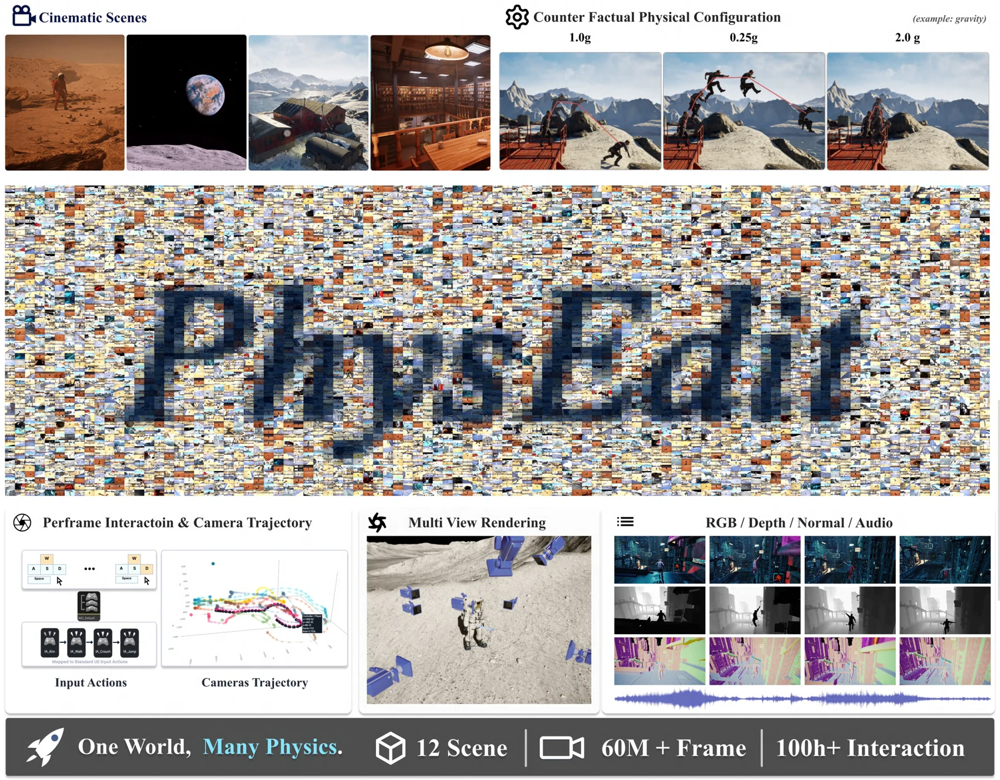

<div align="center">

<p>
  <a href="assets/physeditworld-overview.webp">
    
  </a>
</p>

<h1>PhysEditWorld</h1>

<p><strong>A Large-Scale Dataset Toward Physics-Editable World Models</strong></p>

<p>
  Bin&nbsp;Hu<sup>*</sup>, Yanwen&nbsp;Ma<sup>*</sup>, Jiehui&nbsp;Huang, Ziliang&nbsp;Zhang, Haoning&nbsp;Wu, Ruicheng&nbsp;Zhang, Yaokun&nbsp;Li, Zijun&nbsp;Wang, Yuechen&nbsp;Zhang, Chun-Mei&nbsp;Tseng, Hanhui&nbsp;Li, Shengju&nbsp;Qian, Jun&nbsp;Zhou, Kaipeng&nbsp;Zhang, Xiaodan&nbsp;Liang, Jiaya&nbsp;Jia, Xiu&nbsp;Li
  <br>
  <sub>* Equal contribution</sub>
</p>

<p>
  <a href="https://yizhiqianbi.github.io/physeditworld/"></a>
  <a href="https://arxiv.org/abs/2606.26694"></a>
  <a href="https://www.modelscope.cn/datasets/GelerCAT/PhysicalWorld"></a>
</p>

</div>

## Abstract

PhysEditWorld is a multimodal dataset for studying how game world models respond to explicit changes in physics. The first release focuses on gravity. The Unreal Engine 5 toolkit implements **matched replay** by running the same recorded actions at several gravity levels with a fixed scene, initial state, character controller, and camera policy.

The dataset spans **12 UE5 scenes**, **100+ hours of gameplay**, and **60M+ rendered frames**. It includes synchronized multi-view RGB, depth, normals, and audio, along with action traces, camera trajectories, engine states, semantic annotations, and gravity labels. The paper reports improvements in gravity-sensitive motion generation and gravity understanding after training with PhysEditWorld. [Full abstract](https://arxiv.org/abs/2606.26694)

## Open-source checklist

- [x] Publish the **dataset** on ModelScope.
- [ ] Release the **UE 5.7 Editor plugin** for scene preparation, action recording, and replay setup.
- [ ] Release the **Linux batch tools** for plan validation, headless replay, rendering, and video encoding.
- [ ] Release the **Third Person rollout demo** with the same movement and jump inputs replayed at **0.5× and 1.0× gravity**.

The planned demo uses the standard UE 5.7 **Third Person** template with **Variant** set to **None**. [Epic’s template guide](https://dev.epicgames.com/documentation/en-us/unreal-engine/third-person-template-in-unreal-engine?application_version=5.7)

## Citation

<details>
<summary>BibTeX</summary>

```bibtex
@misc{hu2026physeditworldlargescaledatasetphysicseditable,
  title         = {PhysEditWorld: A Large-Scale Dataset Toward Physics-Editable World Models},
  author        = {Bin Hu and Yanwen Ma and Jiehui Huang and Ziliang Zhang and
                   Haoning Wu and Ruicheng Zhang and Yaokun Li and Zijun Wang and
                   Yuechen Zhang and Chun-Mei Tseng and Hanhui Li and Shengju Qian and
                   Jun Zhou and Kaipeng Zhang and Xiaodan Liang and Jiaya Jia and Xiu Li},
  year          = {2026},
  eprint        = {2606.26694},
  archivePrefix = {arXiv},
  primaryClass  = {cs.CV},
  url           = {https://arxiv.org/abs/2606.26694}
}
```

</details>
